<div align="center">

# SimplyUI

**A tiny, bloat-free GUI library for quick Windows tools.**

One header + one DLL · nothing to set up · crisp Direct2D text and graphics · 0% CPU when idle


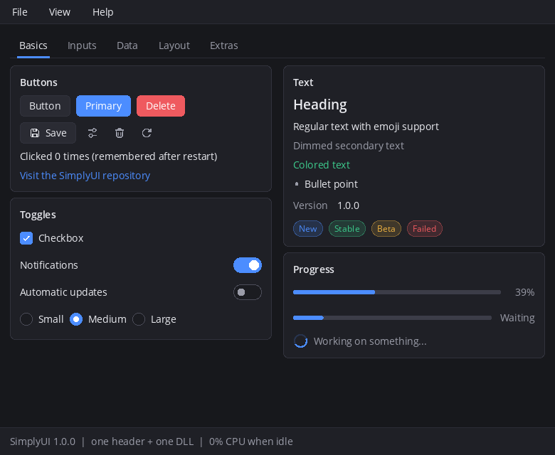

</div>

---

## Why SimplyUI?

- **Two files, zero setup.** Copy `simplyui.h` and `simplyui.dll` into your project and `#include` the header. No `.lib`, no `#define`, no project settings.
- **Your UI is just code.** Widgets take references to *your* variables and return `true` when something changed. No widget objects, no callbacks, no state to sync.
- **Any compiler.** Visual Studio, MinGW or clang, C++11 or newer, 64-bit or 32-bit.
- **Hard to crash.** Forgotten `End...()` calls, bad numbers and calls from the wrong thread are caught and fixed instead of crashing your tool.
- **Looks good, stays light.** Dark and light themes, smooth animations, vector icons, sharp at any DPI, and it only redraws when something changes.

## Quick start

1. Download **SimplyUI-1.0.0.zip** from [Releases](../../releases) and copy **`simplyui.h`** and **`simplyui.dll`** into your project folder.
2. Write your tool:

```cpp
#include "simplyui.h"

int main() {
    std::string name = "World";
    float volume = 0.5f;

    return sui::Run("My Tool", 420, 260, [&] {
        sui::Heading("Hello, " + name + "!");
        sui::InputText("Name", name);
        sui::Slider("Volume", volume, 0.0f, 1.0f);
        if (sui::PrimaryButton("Say hello"))
            sui::Toast("Hello, " + name + "!");
    });
}
```

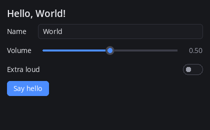

3. Build and run it:

| Compiler | How |
|---|---|
| **Visual Studio** | Make a *Console App*, paste the code, press **F5**. |
| **MinGW-w64** | `g++ main.cpp -o tool.exe -mwindows` |
| **clang** | `clang++ main.cpp -o tool.exe` |

The lambda describes the whole window and runs again whenever something changes. When you share your tool, put `simplyui.dll` next to the `.exe` (32-bit programs use `simplyui32.dll`). To hide the console window in Visual Studio, put `#define SIMPLYUI_NO_CONSOLE` above the `#include`.

More detail: **[docs/getting-started.md](docs/getting-started.md)**

## A taste of the API

```cpp
sui::Checkbox("Enabled", enabled);                     // widgets edit your variables...
if (sui::Button("Open", sui::Icon::Folder))            // ...and return true when used
    path = sui::OpenFileDialog("Images|*.png;*.jpg");
sui::Combo("Format", format, {"PNG", "JPEG", "WebP"});

sui::BeginRow({3, 1});                                 // layout: one line split 3:1
sui::InputText("##path", path, "File path");
if (sui::Button("Browse")) path = sui::OpenFileDialog();
sui::EndRow();

if (sui::BeginTable("files", {"Name", "Size"}, sui::TableStriped)) {
    for (auto& f : files) sui::TableRow({f.name, f.size});
    sui::EndTable();
}

if (sui::Button("Start"))                              // background work: Toast() works from any thread
    std::thread([] { DoWork(); sui::Toast("Done!", sui::Level::Success); }).detach();
```

Guides: [layout](docs/layout.md) · [styling](docs/styling.md) · [recipes](docs/recipes.md) · [full API](docs/api.md)

## Features

| | |
|---|---|
| **Widgets** | Buttons (normal, primary, danger, icon), checkbox, toggle, radio buttons, sliders, drag fields, number inputs, text input (single/multi-line, password, search), combo box, list box, tabs, segmented control, collapsing headers, tree view, progress bars, spinner, badges, links, color picker |
| **Data** | Tables (striped, sortable, resizable, scrollable), line and bar plots, thread-safe log view, images (PNG, JPG, BMP, GIF, ICO, TIFF) |
| **Layout** | Automatic label column, rows, columns, cards, scroll areas, horizontal groups, footer bar, menu bar, flexible widths |
| **Overlays** | Menus and sub-menus, context menus, popups, modal dialogs, tooltips, toast notifications |
| **System** | Native file/folder dialogs, message boxes, drag & drop, clipboard, shortcuts, global hotkeys, always-on-top, settings saved to `%APPDATA%`, UTF-8 command line |
| **Background tools** | Tray icon, start hidden, single instance (files go to the running window), taskbar progress, Windows notifications; hotkeys and timers keep working while the window is minimized or hidden |
| **Look & feel** | Dark, light and system themes, custom or Windows accent color, fonts, 55 vector icons, animations, dark title bar, per-monitor DPI |
| **Custom drawing** | Canvas with lines, shapes, curves, text, images and icons |

## Examples

Ready-to-run builds are in the `examples` folder of the release zip; the source is in [`examples/`](examples).

| | |
|---|---|
| 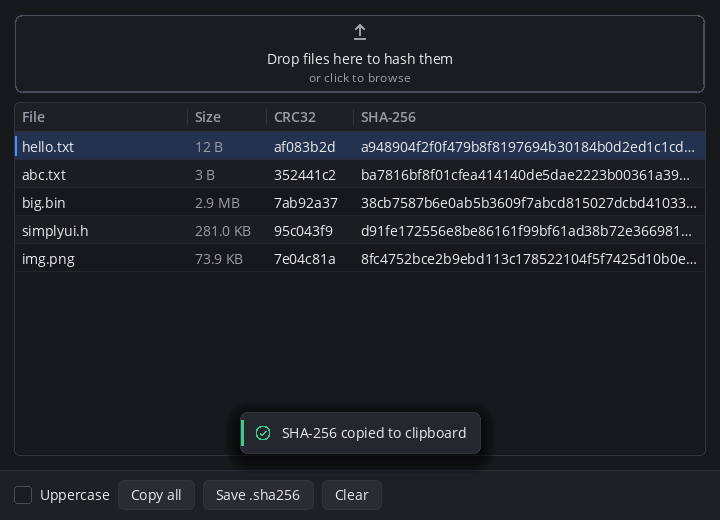<br>**[file_hasher](examples/file_hasher/main.cpp)** - drop files to get CRC32 + SHA-256 in a background thread. | 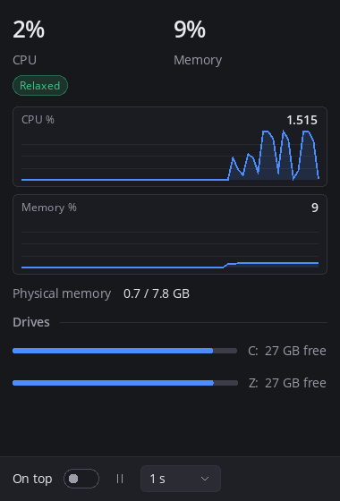<br>**[system_monitor](examples/system_monitor/main.cpp)** - live CPU, memory and disk usage with plots and a global hotkey. |
| 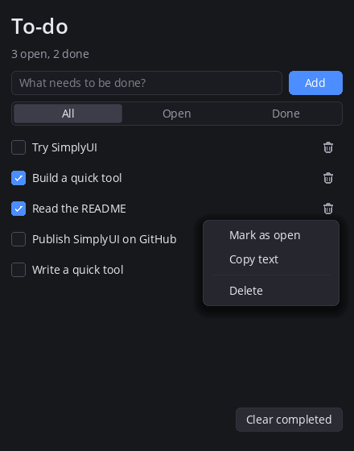<br>**[todo](examples/todo/main.cpp)** - a to-do list that remembers your tasks between runs. | 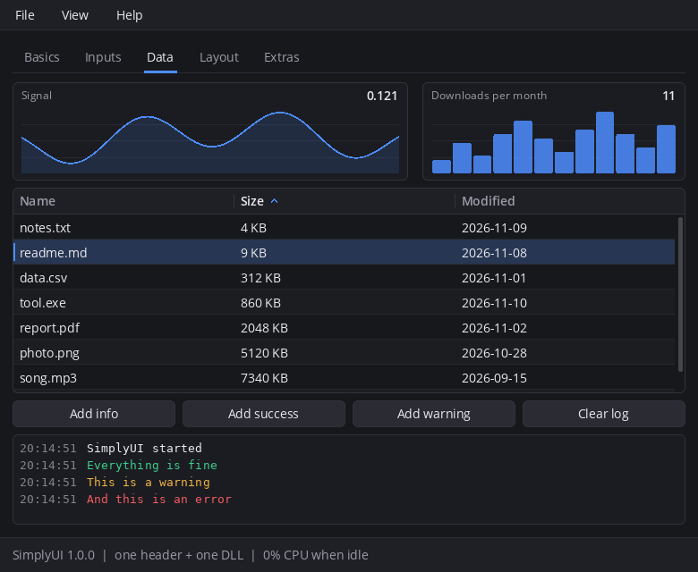<br>**[showcase](examples/showcase/main.cpp)** - every widget in one window. Start here. |
| 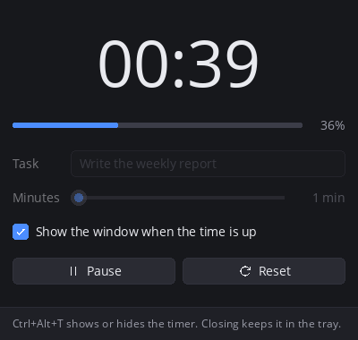<br>**[timer](examples/timer/main.cpp)** - a focus timer that lives in the tray, with a global hotkey and taskbar progress. | <br>**[hello](examples/hello/main.cpp)** - the smallest useful program. |

<details>
<summary><b>More screenshots</b></summary>

| Inputs | Menus |
|---|---|
| 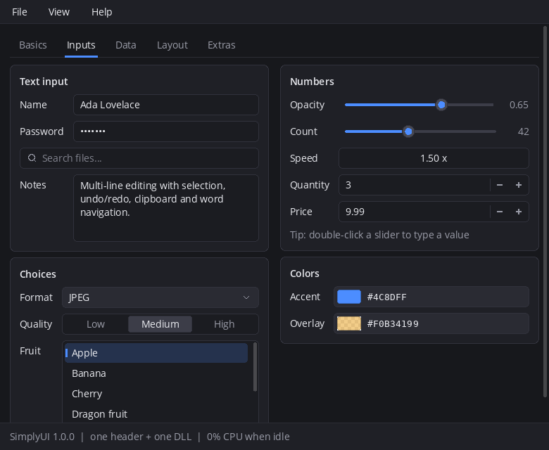 | 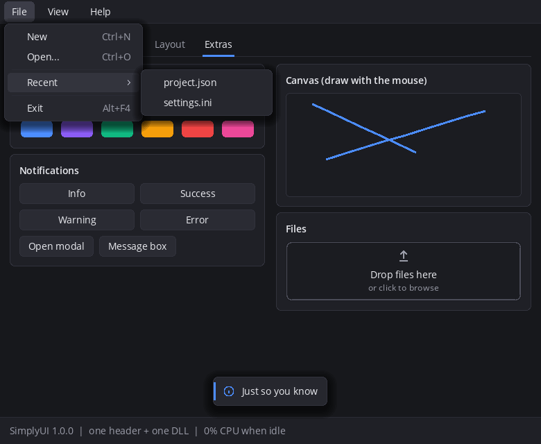 |
| **Light theme** | **Modal dialog** |
| 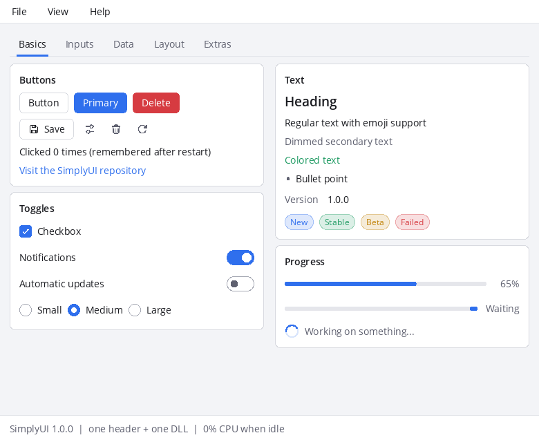 | 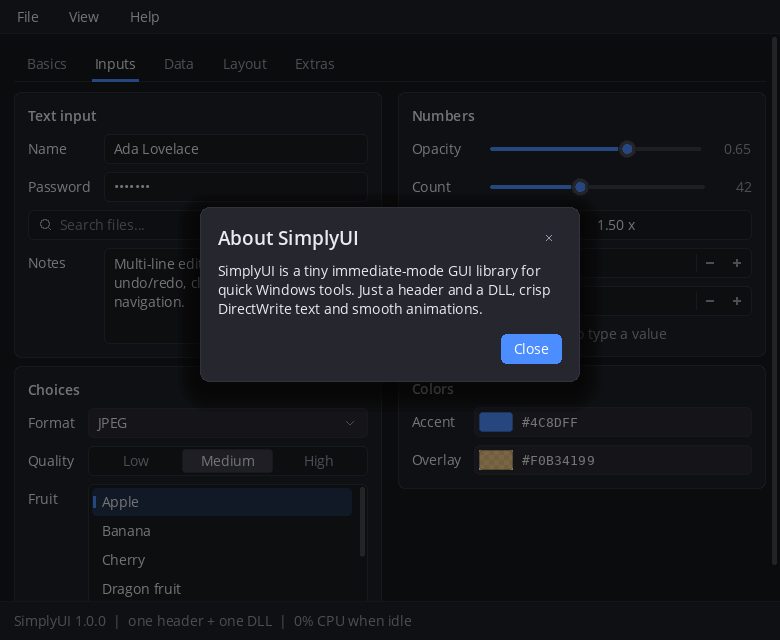 |
| **Layout** | **Canvas, toasts, drop zone** |
| 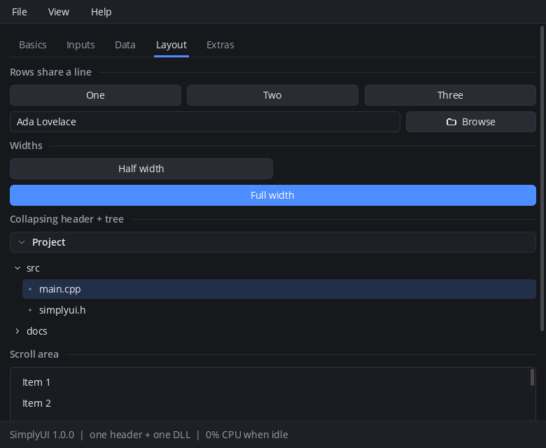 | 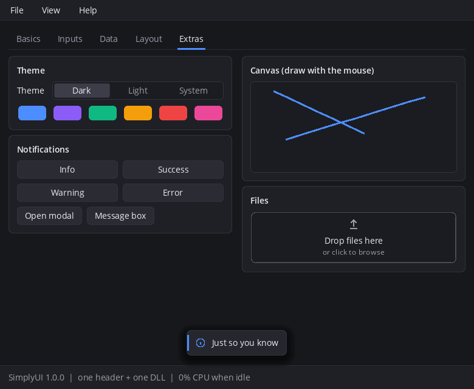 |

</details>

## Making a release

Install Visual Studio 2017 or newer (Community is free) with **Desktop development with C++**, then **double-click `build.bat`**. It builds both DLLs and the examples and creates `release\SimplyUI-<version>.zip`, ready to upload as a GitHub release.

## Project layout

```
include/simplyui.h     the header programs include (the whole API, with comments)
src/simplyui.cpp       the library, compiled into simplyui.dll / simplyui32.dll
examples/              hello, showcase, file_hasher, system_monitor, todo, timer
docs/                  guides and API reference
build.bat              one click: DLLs + examples + release zip
```

Requirements: Windows 7 SP1 or newer; any C++11 compiler for your program.

## License

MIT - see [LICENSE](LICENSE). Use it in anything, commercial or not.
